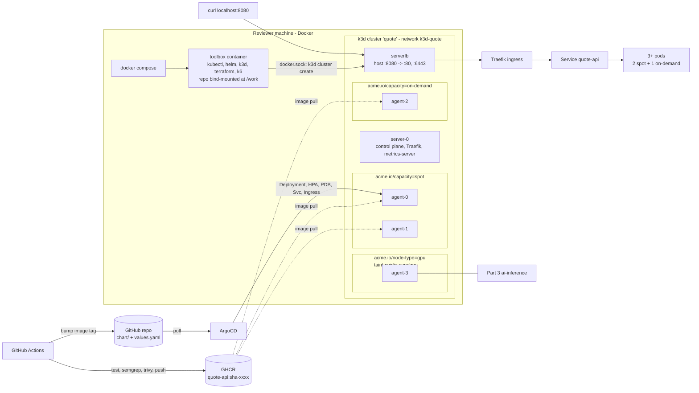

# quote-api

A small Go API, shipped to GHCR by GitHub Actions and deployed by ArgoCD onto a local 4-agent k3d cluster
that simulates spot/on-demand/GPU nodepools

## Quick start

Requirements: >= 6GB free memory, Docker (with Compose v2)

```bash
git clone <this-repo> && cd <this-repo>
docker compose up -d        # builds the toolbox, creates the k3d cluster, runs troubleshoot/prepare.sh
./scripts/run-all.sh        # runs all task scripts in sequence, then does a curl from the host
curl http://localhost:8080/api/quote
./scripts/99-teardown.sh    # removes the cluster and the toolbox
```

## Architecture



Toolbox container controls host Docker daemon through its socket, k3d nodes are not nested. They share the `k3d-quote` network, so `kubectl` inside the toolbox talks to `k3d-quote-serverlb:6443` by name

## Script references

| Script | Functions | When |
|---|---|---|
| `00-cluster.sh` | Creates k3d (1 server + 4 agents, k3s v1.36), writes kubeconfig, runs `troubleshoot/prepare.sh`, makes Traefik HA |  on `docker compose up`; safe to re-run |
| `20-deploy.sh` | Installs ArgoCD (Helm), applies the `Application` at `chart/`, waits for `Healthy`, `curls` ingress | after bootstrap |
| `25-reclaim-drill.sh` | Drains a spot node running the app while a `curl` loop hitting ingress, shows pods moving, uncordons; fails on any non-200 or if no replica stays on on-demand | after 20 |
| `30-troubleshoot.sh` | Applies `broken-app.yaml` (to a fresh cluster only), then `fixed-app.yaml`, then runs `troubleshoot/verify.sh` | any time after bootstrap |
| `50-validate-tf.sh` | `terraform fmt -check`, `init -backend=false`, `validate` on `terraform/` (Cloudflare) | any time |
| `51-validate-karpenter.sh` | Installs Karpenter v1 CRDs (no controller) and server-side dry-runs `karpenter/` | after bootstrap |
| `run-all.sh` | Runs all of the above in order + a `curl` from the host | after `docker compose up -d` |
| `99-teardown.sh` | Deletes the cluster, then `docker compose down` | when done |

## Repo map

* `app/`:Go service + Dockerfile
* `chart/`: Helm chart
* `argocd/`: Application
* `cluster/`: cluster add-on config
* `troubleshoot/`: part 3
* `.github/workflows/ci.yml`: part 4
* `karpenter/` part 5a
* `terraform/`: part 5b
* [TROUBLESHOOTING.md](TROUBLESHOOTING.md)
* [MIGRATION-NOTES.md](MIGRATION-NOTES.md)
* [OPS-ANSWERS.md](OPS-ANSWERS.md)
* [AI-USAGE.md](AI-USAGE.md)

## Design decisions & tradeoffs

- **Go with stdlib onlystandard library only:** ~150 lines; static binary on distroless `nonroot` (~16 MB image), no dependency tree to scan or patch. Prometheus counter is simple written text format; won't touch more complicated libraries unless we need more than handful of metrics
- **CPU work is a wall-clock busy loop:** 100ms of SHA-256 so every request costs real CPU and the HPA has something to react to
- **Graceful shutdown:** on `SIGTERM` the app fails `/readyz`, waits 5s for endpoints/Traefik to drop it, then drains, so reclaim drill (or
real world deployment scenarios) can see no failed requests instead of 5xx
- **Affinity**:
  * Required affinity `acme.io/capacity in (spot, on-demand)` (avoid GPU nodes/k3s server)
  * Preferred affinity to spot (weight 100)
  * Hard topology spread on `acme.io/capacity` with `maxSkew: 1` -> at 3 replicas the second pod *must* go to on-demand, giving 2 spot + 1 on-demand
  * Soft topology spread on hostname so a drain can double up on the surviving spot node
  * `nodeTaintsPolicy: Honor` drops cordoned nodes from the skew count, so the hard rule doesn't deadlock during a drain
  * Limitations:
    * Scaling out keeps spot/on-demand balanced (10 replicas -> 5/5), so cost stays high under load
    * Spread is only enforced at scheduling: a scale-down can remove the on-demand pod. Descheduler with `RemovePodsViolatingTopologySpreadConstraint` can help but out of scale for this exercise
- **No `replicas` in Deployment:** HPA owns this to avoid conflicting with ArgoCD selfhealing
- **GitOps image flow:** CI pushes `sha-<short>` and commits that tag into `chart/values.yaml`. ArgoCD tracks the branch, so git commit = deploy, git rollback = revert
- **Ingress HA (found by the drill):** k3s ships Traefik as 1 replica with no PDB. When the drill drained the spot node that hosted Traefik, every request failed. `cluster/traefik-ha.yaml` (a k3s HelmChartConfig) sets 2 replicas on different hosts, a PDB with `minAvailable: 1`, and a 5 s accept grace on shutdown. The drill now passes when it drains a Traefik node.
- **Golden Rule CI** (`.github/workflows/golden-rule.yml`): clean GitHub runner runs `docker compose up -d` and `./scripts/run-all.sh` after every green `ci` on main, on harness changes, and every Monday to catch upstream drift (k3s images, charts, CRDs)
- **Toolbox:** composed and build (~1 minute build time) locally -> don't have to publish/version image. Multi-stage build checking tool binaries against their sha256 checksums. Final product is a toolbox image of ~148MB
- **Part 5b tested against a real zone:** spare domain used for this. `plan` showed 1 import, 2 adds, 0 changes; `apply` succeeded; a second `plan` showed no drift
- **No Alpine:** `musl`'s resolver can bring DNS surprises so I used `distroless/static-debian13` for `glibc`

## Troubleshooting on the reviewer's machine

- **Port 8080 is in use:**
  1. Run `./scripts/99-teardown.sh` if a cluster exists. The cluster keeps the port that it got at creation
  2. Run `HOST_PORT=18080 docker compose up -d`
  3. Run `HOST_PORT=18080 ./scripts/run-all.sh`
- **Pods stay Pending, or the system is slow:** k3s nodes + ArgoCD use ~6 GB of memory
  1. On Docker Desktop, open Settings > Resources
  2. Increase the memory to a minimum of 6 GB
- **Docker socket is not at `/var/run/docker.sock`** (rootless Docker or Podman):
  1. In `docker-compose.yml`, change the socket volume to the path of your socket e.g.: `/run/user/<uid>/podman/podman.sock`
- **Bootstrap failed:**
  1. Run `docker compose logs toolbox` to see error messages
  2. Run `./scripts/00-cluster.sh` to try the bootstrap again
